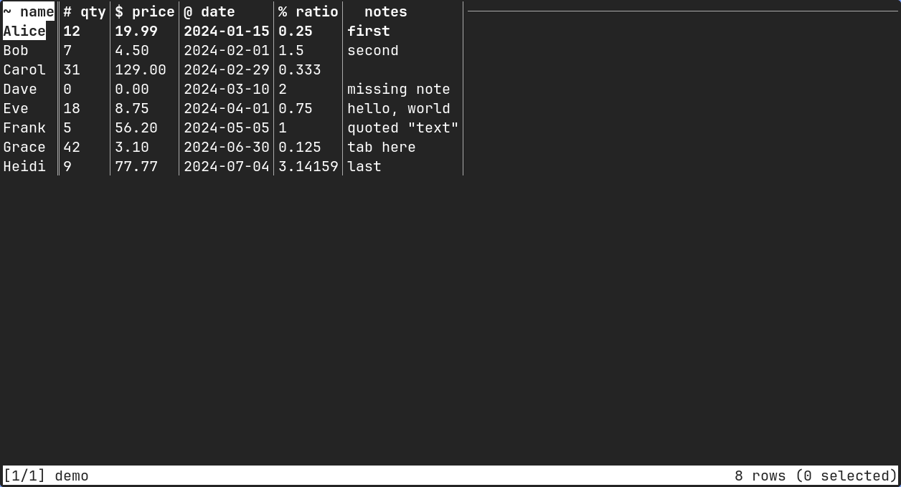

# tam-data

A terminal spreadsheet multitool written in C, inspired by
[VisiData](https://www.visidata.org/). The aim is interactive tabular data
exploration and editing with a small runtime footprint and first-class Linux
virtual console support, without a Python runtime.

**Early development: the current version, 0.2.0, implements the Phase 1 CSV/TSV MVP.**
It opens and saves CSV/TSV files, accepts piped `stdin`, and supports grid and
column navigation. Search, filtering, sorting, and cell editing are the next
milestones. The long-term ambition is VisiData's core workflows; full feature
parity is not a current capability.



The screenshot shows the current demo, including typed columns, a pinned
name column, and the row-selection status bar. See
[capture details](docs/images/README.md).

## What works today

- Loading CSV/TSV files via `mmap` and piped `stdin` (`cat data.csv | tam-data`)
  with `-d`/`--delimiter`, `--csv`, `--tsv`, and `--no-header` options.
- Grid navigation with arrow keys or `h`/`j`/`k`/`l`, paging, row/column jumps,
  distinct-value jumps (`<`/`>`), and blank-cell jumps (`{`/`}`).
- Row selection, column hiding/unhiding (`-`/`gv`), reordering (`H`/`L`),
  renaming (`^`), autosizing/manual width (`_`/`g_`/`z_`), pinning (`!`),
  and type changes (`#`/`%`/`$`/`@`/`~`/`z~`).
- Atomic CSV/TSV saving (`Ctrl+S`) via `tam_fs_write_atomic`.
- Typed values, sheet-stack infrastructure, a prompt editor, and a terminal
  renderer with Linux console and modern terminal profiles.
- Strict C11 compilation and an AddressSanitizer/UndefinedBehaviorSanitizer
  test suite.

See [the roadmap](ROADMAP.md) for planned features and
[the Phase 1 workplan](plans/P1-WORKPLAN.md) for the CSV/TSV MVP specification.

## Build on Linux

Tamlinux is not required to build the demo. You need a C11 compiler, POSIX
development headers and libc, GNU Make, Git, `pkg-config`, and
[`libtam` >= 0.4.0](https://github.com/greenermoose/libtam).
The tests also need a compiler with ASan/UBSan support, such as GCC or Clang.
Other operating systems have not been verified.

`tam-data` uses the core static `libtam.a` archive. The optional portal,
display, and session libraries are not needed; neither are D-Bus development
files, ncurses, or Python.

From a parent directory containing this checkout, build and install the
library into a development prefix owned by your user:

```sh
git clone https://github.com/greenermoose/libtam.git
make -C libtam core
make -C libtam install-core PREFIX="$HOME/.local/dev"
```

Then build and test this checkout using that prefix explicitly:

```sh
cd tam-data
make LIBTAM_PREFIX="$HOME/.local/dev"
make test LIBTAM_PREFIX="$HOME/.local/dev"
./build/tam-data --demo
```

If `libtam` is already installed where `pkg-config` can find it, plain
`make` and `make test` work. To expose a custom prefix to `pkg-config`:

```sh
export PKG_CONFIG_PATH="$HOME/.local/dev/lib/pkgconfig${PKG_CONFIG_PATH:+:$PKG_CONFIG_PATH}"
pkg-config --atleast-version=0.4.0 libtam
make
```

Running from the build directory is sufficient. An optional development
installation uses an explicit prefix:

```sh
make install PREFIX="$HOME/.local/dev"
```

The installed executable is `~/.local/dev/bin/tam-data`. `make uninstall`
with the same `PREFIX` removes it. The Makefile's implicit prefix depends
on whether Nix is detected, so specify it when installing.

## Try the demo

Run `./build/tam-data --demo` from an interactive terminal. A Linux virtual
console (`TERM=linux`) is a design target alongside terminal emulators.
The demo contains eight built-in rows; no input file is required.

| Key | Action |
| --- | --- |
| Arrow keys or `h` / `j` / `k` / `l` | Move between cells |
| `Ctrl+F` / `Ctrl+B` | Page down / up |
| `gg` / `G` | First / last row |
| `gh` / `gl` | First / last visible column |
| `s` / `u` / `t` | Select / unselect / toggle the current row |
| `!` | Pin or unpin the current column |
| `_` / `^` / `-` | Autosize / rename / hide the current column |
| `q` | Close the sheet and exit |

`./build/tam-data --help` lists further controls. Use `Ctrl+S` to save the
current sheet atomically to a `.csv` or `.tsv` file.

## Performance goals

Fast startup and low memory use are goals, not benchmark results. Startup
latency, peak resident memory, and large-file performance have not been
measured for this project. Although the arena and `mmap`-backed CSV/TSV loader
are implemented, passing unit tests do not establish large-file performance.

## License and development provenance

Copyright (C) 2026 Fred Horch and contributors.

This project's code and documentation are licensed under the GNU General
Public License, version 3 or (at your option) any later version
(`GPL-3.0-or-later`). See [LICENSE](LICENSE).

AI-assisted development, verified commit attribution, and gaps in historical
evidence are recorded in [AI_PROVENANCE.md](AI_PROVENANCE.md).
