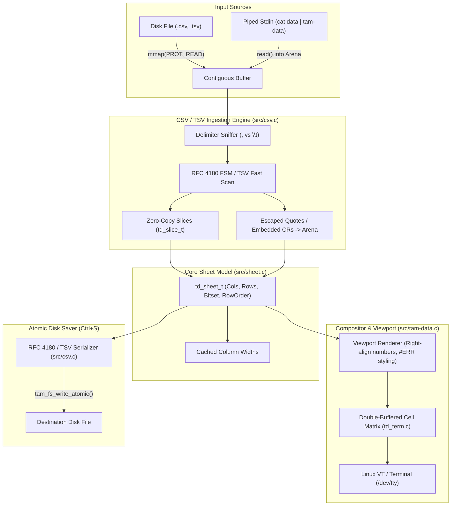
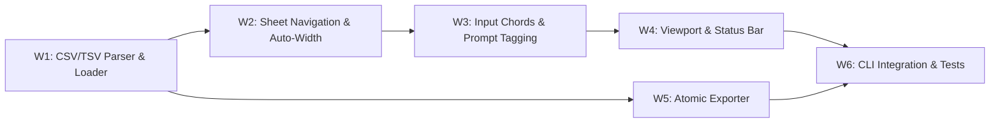

# Implementation Plan: Phase 1 (v0.2.0) Native CSV/TSV Loaders & Grid Navigation (MVP)

The next milestone for `tam-data` is **Phase 1: Native CSV/TSV Loaders & Grid Navigation (MVP / `v0.2.0`)**, transitioning the project from a foundation demo into a fully functional, zero-Python tabular multitool.

---

## Goal Description

Phase 0 established the core data structures, raw termios VT engine, and demo shell. Phase 1 delivers the Minimum Viable Product (MVP):
1. **Zero-Copy CSV & TSV Loaders (`src/csv.*`)**: An RFC 4180 compliant CSV parser and TSV scanner capable of `mmap`-backed zero-copy slicing for disk files and streaming ingestion for piped `stdin` (`cat data.csv | tam-data`).
2. **Sheet Viewport & Status Bar Enhancements (`src/tam-data.*`)**: Cached auto-width calculations ($O(1)$ per frame), right-aligned numeric formatting, bold/red `#ERR` cell styling, and coordinate status bar display (`[1/1] file.csv | r3 c2:qty`).
3. **Core Grid & Column Navigation (`src/sheet.*`, `src/input.*`)**: Value jumps (`<`, `>`), null/blank jumps (`{`, `}`), column reordering (`H`, `L`), column width controls (`_`, `g_`, `z_`, `gv`), column renaming (`^`), and type casting.
4. **Atomic File Exporter (`src/csv.*`)**: Atomic disk saving via `Ctrl+S` (`tam_fs_write_atomic`), honoring visual column order, hidden columns, and sorted row permutations.



---

## User Review Required

> [!IMPORTANT]
> **Piped `stdin` Terminal Allocation:** When `tam-data` reads data from `stdin` (`cat file.csv | tam-data`), `stdin` is a pipe, not a TTY. The terminal engine (`td_term_open`) must open `/dev/tty` directly for terminal raw mode and keyboard input. This is standard for interactive UNIX utilities (e.g. `less`, `fzf`).

> [!NOTE]
> **TSV vs CSV Escaping Behavior:** For CSV exports, RFC 4180 rules apply (fields with commas, newlines, or quotes are wrapped in quotes, with internal quotes doubled). For TSV exports, newline and tab characters in cell text cannot be quoted per traditional Unix TSV semantics; they will be sanitized to single spaces to maintain strict one-record-per-line TSV format.

> [!TIP]
> **Build Convenience:** `Makefile` will be updated to automatically probe `PREFIX` (`$(HOME)/.local/dev`) for `include/tam.h` if `LIBTAM_PREFIX` is not explicitly set, allowing `make` and `make test` to run seamlessly without needing manual environment variables.

---

## Open Questions & Agreed Defaults

1. **Synthetic Header Naming:** When `--no-header` is passed, or when ragged rows have more columns than the header line, synthetic columns will be named `col1, col2, ... colN`.
2. **`Ctrl+S` Default Destination:** The save prompt will pre-fill with `s->source_path` if loaded from a file on disk, or `output.csv` if loaded from `stdin`.

---

## Proposed Changes

Grouped logically by architectural dependency layer:



---

### Build System & Build Configuration

#### [MODIFY] Makefile
- Add `src/csv.c` to `SRC`.
- Add `tests/test_csv.c` to test harness build.
- If `LIBTAM_PREFIX` is unset and `$(PREFIX)/include/tam.h` exists, default `LIBTAM_PREFIX := $(PREFIX)`.

---

### Core Sheet Model & Navigation

#### [MODIFY] src/sheet.h
#### [MODIFY] src/sheet.c
- **Buffer & Mmap Ownership:**
  - Add `void *mmap_base; size_t mmap_len;` and `char *buf_base; size_t buf_len;` to `td_sheet_t`.
  - In `td_sheet_free()`, `munmap()` if `mmap_base != NULL` and free `buf_base` if allocated.
- **Cached Column Width:**
  - Add `int cached_width;` to `td_col_t`.
  - In `td_sheet_col_width()`, return `cached_width` if set; otherwise compute by sampling up to 1,000 rows plus active viewport, caching the result.
  - Invalidate `cached_width` when renaming, changing type, setting cell, or resizing column.
- **Value & Null Cell Jumps:**
  - `bool td_sheet_jump_value(td_sheet_t *s, int dir)`: jump cursor to next/previous row with a distinct value in the current column (respecting `s->row_order`).
  - `bool td_sheet_jump_null(td_sheet_t *s, int dir)`: jump cursor to next/previous row where cell is null or empty string.
- **Column Reordering & Width Manipulation:**
  - `bool td_sheet_move_col(td_sheet_t *s, size_t col, int dir)`: swap `cols[col]` with the adjacent visible column in direction `dir` (`H` left, `L` right), updating `s->cursor_col`.
  - `void td_sheet_autosize_all_cols(td_sheet_t *s)` (`g_`).
  - `bool td_sheet_set_col_width(td_sheet_t *s, size_t col, int width)` (`z_`).
  - `void td_sheet_unhide_all_cols(td_sheet_t *s)` (`gv`).

---

### Native CSV/TSV Parser & Atomic Saver

#### [NEW] src/csv.h
#### [NEW] src/csv.c
- **Options Struct:**
  ```c
  typedef struct {
      char delimiter;     /* ',' or '\t' or custom; '\0' for auto */
      bool has_header;    /* true: first row is names; false: synthetic col1..N */
      bool strict_tsv;    /* fast byte scanner for tab-delimited */
  } td_csv_opts_t;
  ```
- **Parsing Engine:**
  - Byte-by-byte RFC 4180 deterministic state machine: `START_RECORD`, `START_FIELD`, `UNQUOTED`, `QUOTED`, `QUOTE_IN_QUOTE`, `CR_SEEN`.
  - Strip UTF-8 BOM (`0xEF, 0xBB, 0xBF`) on line 1 if present.
  - Zero-copy path: cells without escaped quotes or embedded `\r\n` store slices pointing directly into backing buffer.
  - Escaped quotes (`""` -> `"`) allocate unescaped string in `s->arena`.
  - Ragged row handling: dynamically allocate new columns `colN` if rows exceed header count.
- **Loader Functions:**
  - `char td_csv_detect_delimiter(const char *path, const char *buf, size_t len);`
  - `td_sheet_t *td_csv_load_mem(const char *name, const char *path, const char *buf, size_t len, const td_csv_opts_t *opts, char *err, size_t err_cap);`
  - `td_sheet_t *td_csv_load_fd(int fd, const char *name, const td_csv_opts_t *opts, char *err, size_t err_cap);`
  - `td_sheet_t *td_csv_load_file(const char *path, const td_csv_opts_t *opts, char *err, size_t err_cap);`
- **Exporter Functions:**
  - `tam_str_t td_csv_format_sheet(const td_sheet_t *s, char delimiter);`
  - `bool td_csv_save_sheet(td_sheet_t *s, const char *path, char delimiter, char *err, size_t err_cap);`
  - Write output atomically via `tam_fs_write_atomic(path, data, len, 0644)`.

---

### Input Handling & Prompt Dispatch

#### [MODIFY] src/input.h
#### [MODIFY] src/input.c
- **Command Definitions:**
  - `TD_CMD_NEXT_VALUE` (`>`), `TD_CMD_PREV_VALUE` (`<`)
  - `TD_CMD_NEXT_NULL` (`}`), `TD_CMD_PREV_NULL` (`{`)
  - `TD_CMD_MOVE_COL_LEFT` (`H`), `TD_CMD_MOVE_COL_RIGHT` (`L`)
  - `TD_CMD_AUTOSIZE_ALL_COLS` (`g_`), `TD_CMD_SET_COL_WIDTH` (`z_`)
  - `TD_CMD_UNHIDE_ALL_COLS` (`gv`), `TD_CMD_SAVE_SHEET` (`Ctrl+S` / `0x13`)
- **Prompt Action Tagging:**
  ```c
  typedef enum {
      TD_PROMPT_NONE = 0,
      TD_PROMPT_RENAME_COL,
      TD_PROMPT_COL_WIDTH,
      TD_PROMPT_SAVE_SHEET
  } td_prompt_kind_t;
  ```
  Add `kind` to `td_prompt_t` and dispatch appropriately when `TD_PROMPT_ACCEPT` fires.

---

### Terminal Viewport, Status Bar & CLI

#### [MODIFY] src/tam-data.h
#### [MODIFY] src/tam-data.c
- **Cell Viewport Alignment & Styling:**
  - For numeric columns (`INT`, `FLOAT`, `CURRENCY`), right-align formatted values within the column width.
  - Highlight `#ERR` cells in bold red attribute.
- **Status Bar Display:**
  - Left: `[<depth>/<total>] <sheet_name> | r<cursor_row+1> c<cursor_col+1>:<col_name>`.
  - Center: Active prompt with cursor or transient status message.
  - Right: Prefix indicator (`g`, `z`), row count, selection count.
- **CLI Ingestion & Main Loop:**
  - Add CLI flags: `-d/--delimiter`, `--csv`, `--tsv`, `--no-header`, `--demo`, `-v/--version`, `-h/--help`.
  - If positional argument is `-` or no argument and `!isatty(STDIN_FILENO)`, stream from `STDIN_FILENO`.
  - Open `/dev/tty` for `td_term_open` when stdin is redirected.
  - Connect `Ctrl+S` to open save prompt (`save to: <path>`) and call `td_csv_save_sheet`.
  - Connect `z_` to open width prompt (`column width: <num>`).

---

## Verification Plan

### Automated Tests
Run the comprehensive test suite with AddressSanitizer and UndefinedBehaviorSanitizer enabled:

```sh
# Run all unit tests under ASan/UBSan with leak detection
make LIBTAM_PREFIX=/home/fred/.local/dev test
```

New and updated tests to include:
1. `tests/test_csv.c`:
   - RFC 4180 parsing: unquoted fields, quoted fields, doubled quotes `""`, embedded newlines `\n` and `\r\n`, trailing newlines, BOM stripping.
   - Ragged rows and `--no-header` synthetic column naming.
   - Delimiter detection (`.csv` vs `.tsv` vs content sniffing).
   - In-memory, `mmap` file loading, and `stdin` pipe simulation.
   - Atomic export round-trip verifying hidden columns are omitted and row order is preserved.
2. `tests/test_sheet.c`:
   - Value jumps (`<`, `>`) across matching and distinct values.
   - Blank jumps (`{`, `}`) to null and empty cells.
   - Column reordering (`H`, `L`) and width operations (`_`, `g_`, `z_`, `gv`).
3. `tests/test_input.c`:
   - Key decoding for `<`, `>`, `{`, `}`, `H`, `L`, `g_`, `gv`, `z_`, `Ctrl+S`.
   - Prompt kind state machine transitions.
4. `tests/test_term.c`:
   - Verification of numeric right-alignment and status bar coordinate strings.

### Manual Verification
1. **File Loading:**
   ```sh
   ./build/tam-data test.csv
   ./build/tam-data test.tsv
   ```
2. **Piped Pipeline Ingestion:**
   ```sh
   cat test.csv | ./build/tam-data
   ```
3. **Interactive Grid Testing:**
   - Press `<` and `>` to jump across distinct values.
   - Press `{` and `}` to jump across empty cells.
   - Press `H` and `L` to reorder columns.
   - Press `z_` to enter a numeric column width; press `_` to auto-size; press `gv` to unhide all.
   - Press `Ctrl+S` to save modifications to a new file and inspect the written file.
